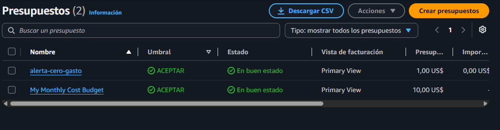

# Spookython — simulación de evacuación de Manta

Proyecto de simulación para observar cómo cambian las rutas de evacuación ante amenazas y bloqueos en la red vial de Manta. El backend FastAPI y `simulador.py` mantienen la lógica y el estado de la partida; el frontend es un observatorio visual conectado a esos datos.

## Qué hace el proyecto

Spookython simula una evacuación urbana en Manta con sobrevivientes, refugios,
zombis y cierres viales que cambian durante la partida. El servidor calcula el
siguiente movimiento seguro usando el grafo vial real, publica el estado del
mundo y registra los motivos de cada cambio de ruta.

La demostración incluye tres rondas:

- **Ronda 1 — Anochecer:** 20 sobrevivientes y caminantes.
- **Ronda 2 — Medianoche:** 80 sobrevivientes, caminantes, corredores y hordas; un puente se bloquea en vivo.
- **Ronda 3 — Apocalipsis:** 200 sobrevivientes, todos los tipos de zombis y dos bloqueos dinámicos.

Cada tick dura dos segundos. Primero se mueven los zombis, después los
 sobrevivientes y finalmente se resuelven mordidas, rescates y eventos.

## Estructura

- `main.py`, `routing.py`, `models.py`: API y motor de rutas.
- `simulador.py`: turnos, sobrevivientes, zombis, refugios y eventos.
- `simulation_service.py`: inicio y ejecución de las tres rondas dentro del backend.
- `manta_grafo.graphml`: grafo vial local de Manta.
- `frontend/`: interfaz React + TypeScript + Vite.
- `docs/analisis-estado-actual.md`: análisis funcional y pendientes.
- `docs/arquitectura.md`: diagrama y descripción de la arquitectura desplegable.
- `docs/costos.md`: estimación mensual y plantilla para registrar el gasto real.
- `docs/plans/2026-10-27-live-map-design.md`: diseño aprobado del mapa táctico en vivo.

## Ejecutar en desarrollo

Requiere Python y Node.js instalados. En PowerShell, abre dos terminales desde la raíz del repositorio.

**Terminal 1 — backend:**

```powershell
python -m venv .venv
.\.venv\Scripts\python.exe -m pip install -r requirements.txt
.\.venv\Scripts\python.exe -m uvicorn main:app --reload
```

**Terminal 2 — frontend:**

```powershell
cd frontend
npm install
npm run dev -- --host 127.0.0.1
```

Abre la URL que muestre Vite (normalmente `http://127.0.0.1:5173`). En desarrollo, Vite reenvía `/api` al backend en `http://127.0.0.1:8000`. Puedes cambiar el destino con `VITE_DEV_API_TARGET` en `frontend/.env.local`; `frontend/.env.example` contiene los valores iniciales.

El botón demo inicia la Ronda 1; el selector del mapa permite cambiar a las rondas 2 y 3 con `POST /simulacion/demo` y el número de ronda. Las configuraciones son: R1, 20 sobrevivientes y caminantes; R2, 80 sobrevivientes con caminantes, corredores, hordas y un puente colapsado; R3, 200 sobrevivientes con todos los tipos de zombis y dos cierres viales. Las cantidades por tipo y los turnos de eventos están definidos en `simulation_service.py` a partir del análisis del reto. Cada ronda avanza en turnos de dos segundos y termina al resolver a todos los sobrevivientes o al llegar al límite de 150 turnos. El mapa consulta `GET /mapa?incluir_calles=false` y `GET /estado`; el navegador no crea posiciones, rutas ni sucesos. Nodos, rutas, trayectos, bloqueos, refugios ocupados y eventos provienen de la API. Los sprites distinguen sobrevivientes, mordidos y tipos de zombi; los cierres muestran el recurso de obstáculo del proyecto y los refugios se marcan llenos según su capacidad publicada. El historial completo de eventos queda disponible en el feed desplazable. Leaflet usa mosaicos de OpenStreetMap como fondo geográfico (requieren Internet); el grafo vial y los actores se conservan aunque esos mosaicos fallen. Los controles de zoom y paneo son interactivos; Ajustes muestra detalles del estado publicado. El formulario de operador es visual: todavía no existe autenticación de usuarios en la API. Para un origen distinto en despliegues, configura `VITE_API_BASE_URL` al construir el frontend y agrega ese origen a `SPOOKYTHON_CORS_ORIGINS` en el backend.

`GET /mapa` entrega `metadata`, nodos del `grafo`, `zonas` y `refugios`; con `incluir_calles=true` (predeterminado) también entrega las geometrías viales. El frontend omite esas geometrías para limitar la descarga y usa mosaicos OSM como fondo. `GET /estado` expone posiciones, rutas completas calculadas por el backend, trayectos, resultados, bloqueos y eventos estructurados registrados por el simulador. El estado se mantiene en memoria y se reinicia al reiniciar el backend; no hay una base de datos conectada.

Endpoints principales:

```text
GET  /health
GET  /mapa
GET  /estado
WS   /ws/estado
POST /simulacion/demo
POST /simulacion/prueba-fuego
POST /simulacion/incidente (requiere x-api-key)
POST /paso       (requiere x-api-key)
```

Los endpoints de control (`POST /paso`, `GET /pasos` y `POST /estado`)
requieren `x-api-key`; las lecturas y el inicio de demo son públicos para que
la UI aprobada pueda entrar sin configuración adicional. El WebSocket acepta
la clave en la cabecera `x-api-key` o en el parámetro de conexión `x-api-key`.
La
Prueba de Fuego ejecuta R1, R2 y R3 consecutivamente, con 150 turnos de dos
segundos por ronda. `WS /ws/estado` envía el snapshot inicial y cada estado
publicado por el simulador.

Para demostrar una reacción en vivo durante una ronda, se puede programar un
cierre real con `POST /simulacion/incidente`:

```json
{"arista":["N-0100","N-0101"],"nombre":"Puente bloqueado por el jurado"}
```

El backend valida la arista, lo agenda para el siguiente tick atómico y publica
el bloqueo junto con las rutas recalculadas y los desvíos afectados.

## Despliegue en AWS

Amplify aloja únicamente el frontend estático. FastAPI se ejecuta como un
servicio independiente; la arquitectura documentada usa una instancia EC2
Ubuntu con Nginx como proxy HTTPS.

### Backend en EC2

En la instancia instala Python, Git y Nginx, clona el repositorio y ejecuta:

```bash
sudo apt update
sudo apt install -y git python3-venv nginx
git clone https://github.com/ReyesAdrian-11/hackaton-aws-2026.git
cd hackaton-aws-2026
python3 -m venv .venv
source .venv/bin/activate
pip install -r requirements.txt
```

Configura las variables del backend antes de iniciar FastAPI:

```bash
export SPOOKYTHON_API_KEY="cambia-esta-clave"
export SPOOKYTHON_CORS_ORIGINS="https://TU_APP.amplifyapp.com"
uvicorn main:app --host 0.0.0.0 --port 8000
```

El endpoint de comprobación es `GET /health`. En producción, Nginx debe
terminar HTTPS y reenviar al puerto 8000; no se debe publicar la clave en el
frontend. Para el detalle de componentes consulta [docs/arquitectura.md](docs/arquitectura.md).

### Frontend en Amplify

El archivo `amplify.yml` ya configura el monorepo:

```text
Root directory: frontend
Build command: npm run build
Output directory: dist
```

En **Amplify → App settings → Environment variables** agrega durante el build:

```text
VITE_API_BASE_URL=https://TU_BACKEND_PUBLICO
```

La URL debe ser la dirección HTTPS pública del backend, sin `/api` al final.
Después ejecuta **Redeploy this version**. Si no se define esta variable, el
frontend intenta usar `/api` en el dominio de Amplify y aparece el error 404.

### Prueba de despliegue

```bash
curl https://TU_BACKEND_PUBLICO/health
```

Debe responder un JSON con `status: ok`. Luego abre la URL de Amplify y pulsa
el botón de demo; el navegador debe solicitar directamente
`https://TU_BACKEND_PUBLICO/simulacion/demo`.

## Decisiones de diseño

- FastAPI concentra los contratos HTTP y `SimulationService` controla una sola
  sesión de simulación para evitar carreras entre rondas.
- `WorldStore` mantiene un snapshot en memoria y publica el estado por REST y
  WebSocket. Esto mantiene `/paso` rápido y permite recalcular después de cada
  tick.
- NetworkX usa Dijkstra con pesos de tiempo: la longitud de la arista se
  divide por la velocidad configurada para su tipo de calle. Los bloqueos y
  zombis visibles se excluyen de la ruta.
- Los incidentes se validan contra el grafo, se programan para el siguiente
  tick atómico y producen eventos de bloqueo y desvío observables.
- La capacidad de los refugios se reserva durante la planificación para evitar
  que varios sobrevivientes reciban simultáneamente el último cupo.
- La simulación usa memoria local porque la prueba de fuego corre como una
  sesión única. Una versión multiinstancia debe reemplazar `WorldStore` por
  Redis/ElastiCache o una persistencia compartida.

## Limitaciones conocidas

- El archivo vial actual contiene aproximadamente 6.769 nodos y 18.207 aristas;
  es más detallado que el escenario reducido de unas 300 intersecciones.
- El estado se pierde al reiniciar el proceso y el WebSocket actual mantiene
  conexiones dentro de una sola instancia.
- AWS Budget, HTTPS, Nginx y CloudWatch requieren configuración en la cuenta;
  el repositorio no contiene credenciales ni crea recursos automáticamente.
- OpenStreetMap se usa como mapa base y requiere conectividad del navegador.
- Las velocidades por tipo de calle son valores medios de simulación y deben
  calibrarse si el jurado entrega una tabla oficial diferente.

## Presupuesto y control de costos AWS

Se configuraron presupuestos para detectar gasto inesperado:



La captura muestra `alerta-cero-gasto` con umbral de 0 USD y `My Monthly Cost
Budget` con límite mensual de 10 USD. La estimación y los supuestos de costo se
encuentran en [docs/costos.md](docs/costos.md). La instancia EC2 debe detenerse
cuando termine la demostración si no se necesita mantener la API disponible.

## Validación

```powershell
.\.venv\Scripts\python.exe -m pytest -q
cd frontend
npm run build
npm run lint
```

Ejecuta `npm` dentro de `frontend/`; el `package.json` no está en la raíz.

## Arquitectura y costos

- [Diagrama de arquitectura](docs/arquitectura.md)
- [Declaración de costos](docs/costos.md)

