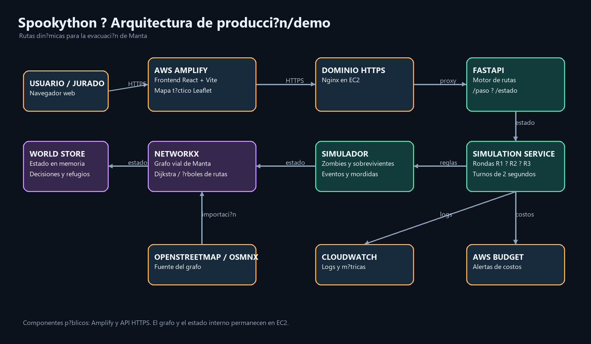

# Arquitectura

El diagrama muestra el flujo entre el frontend público, el backend desplegado en EC2, el simulador y el grafo vial de Manta.

Fuente editable: [arquitectura.mmd](arquitectura.mmd)

## Componentes

- **AWS Amplify:** aloja el frontend React + Vite.
- **Nginx en EC2:** termina HTTPS y redirige las peticiones a FastAPI.
- **FastAPI:** expone `/paso`, `/pasos`, `/estado`, `/mapa` y las rutas de simulación.
- **NetworkX:** calcula rutas usando el grafo GraphML de Manta.
- **SimulationService:** ejecuta las rondas y publica el estado.
- **WorldStore:** mantiene temporalmente el estado de la partida en memoria.
- **OpenStreetMap/OSMnx:** fuente del grafo vial.
- **CloudWatch:** monitoreo y logs pendientes de configurar completamente.
- **AWS Budget:** control y alerta de costos.

## Componentes públicos

- Frontend Amplify.
- API HTTPS detrás de Nginx.
- Mosaicos públicos de OpenStreetMap.

El grafo, el estado de la simulación y los procesos internos de EC2 no deben exponerse directamente.
